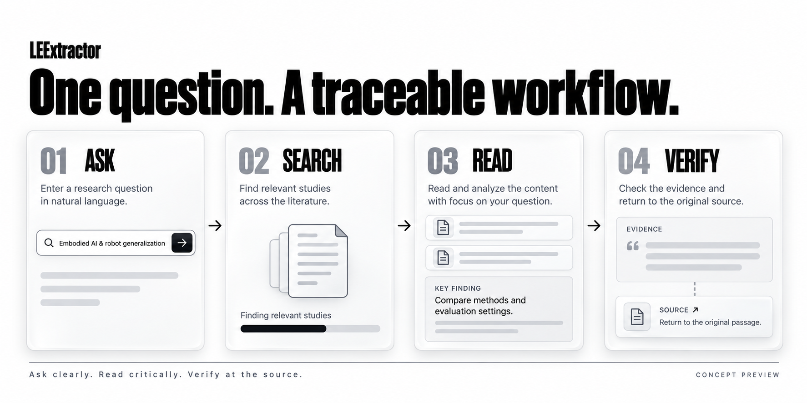

# LEExtractor

**简体中文** · [English](README.en.md)

> **从模糊的研究意图，到一条能复核的证据链。**
> From a fuzzy research intent to a reviewable evidence chain.

| | |
|---|---|
| **线上体验** | <https://leextractor.duckdns.org> |
| **当前版本** | v0.9.14（Vue 3 工作台 + 本机 FastAPI + MCP） |
| **Windows 便携版** | [下载](download/LEExtractor_v0.9.14_Windows_portable.zip) · [Releases](https://github.com/26Wesly3/LEExtractor/releases) |
| **Benchmark** | BEIR SciFact · 5,183 篇候选 · 30 题 · 150 次真实排序 |

## 界面：概念图 与 实拍

| 前期概念图（界面设计示意） | 实际操作录屏（本机真实运行） |
|---|---|
| [](docs/assets/leextractor-hero-4k.png) |  |
| 《概念图》—— 早期界面设计示意，**非运行截图** | 《实拍》—— 大语言模型幻觉样例，来源 OpenAlex / arXiv / Crossref |

<details>
<summary>查看完整工作流概念图（点击展开）</summary>

[](docs/assets/leextractor-workflow-4k.png)

《概念图》—— 探索流程示意，**非运行截图**
</details>

> 实拍动画为 **40 篇真实检索结果**，8.0 秒完成 3 个来源（2 成功 / 1 受限），界面如实显示「部分完成 · 部分文献来源暂时受限」。
> GIF 体积较大时可用 [轻量版](docs/demo/leextractor-demo-small.gif)。

---

## 这是什么

LEExtractor 面向**科研前期探索**：把你一句模糊的研究意图，变成一次**有路径、有身份、有依据**的文献检索，并把整条链路留给下一个人复核。

它不做三件事的假装：

- **不假装找全了**。每个来源的限流、超时、鉴权失败逐源可见，不会塌成「0 篇」。
- **不假装有把握**。未标定就不显示「相关率」；候选研究问题一律标注为待验证假设。
- **不假装是结论**。引文边与推导／语义边严格分开；版图数字只描述「已检索到的文献」。

## 能做什么

**01 / 检索与扩展**
一句话研究意图拆成 object / method / task / scenario，再翻译成各数据库自己的检索式（S2 / OpenAlex 关键词串、arXiv 字段限定、Crossref 元数据）。六源并发抓取，跨库按规范标识去重，引文边继续用真实 references 与 citations 扩展。

**02 / 关系与证据**
引文证据图（PageRank / 社群 / 有向证据路径）、书目耦合、共被引、文本相似各自独立计数。研究版图给出主题、时序、新颖度与覆盖度，每条都附带边界说明。

**03 / 判断与交接**
排序是排序信号，不是筛选结论：人工筛选、标定、全文获取各自保留事实。导出 CSV / RIS / BibTeX / 会话 JSON / 完整证据包（含 `AGENT_HANDOFF.md`、`discovery_trace.jsonl`、`evidence_graph.json`、`landscape.json`、`questions.json`），可导入 Zotero，或交给 Codex / Qoder / WorkBuddy 等工具继续做。

## 快速开始

### 方式一：Windows 便携版（推荐）

1. 下载并**完整解压** [`LEExtractor_v0.9.14_Windows_portable.zip`](download/LEExtractor_v0.9.14_Windows_portable.zip)（或从 [Releases](https://github.com/26Wesly3/LEExtractor/releases) 下载）。
2. 双击 **`Start_LEExtractor.bat`**。
3. 浏览器自动打开 <http://127.0.0.1:8012>，控制台保持打开即运行中。

便携版自带启动逻辑：优先使用包内 `runtime\`，其次 `.venv`，再退到系统 Python；缺依赖会自动创建本地环境安装。**运行不需要 Node.js、显卡或推理 API Key。**

> 模型说明：最小包不含模型权重。没有模型时**词法检索、来源筛选、证据链、导出全部可用**，只有「中文翻译」与「语义排序」会在首次使用时下载（翻译约 116 MB、嵌入约 267 MB，之后复用缓存）。端口被占用时可在启动前 `set LEEXTRACTOR_PORT=8013`。

### 方式二：源码运行

```powershell
git clone https://github.com/26Wesly3/LEExtractor.git
cd LEExtractor
python -m venv .venv
.\.venv\Scripts\python.exe -m pip install -e ".[web]" -c constraints.txt
.\.venv\Scripts\python.exe scripts\launch_web.py --port 8000
```

macOS / Linux 同上，改用 `python scripts/launch_web.py --port 8000`。加 `--skip-models` 可以只开界面不准备模型。

### 配置数据源

S2 / OpenAlex / SerpApi / Unpaywall 凭据可在界面「设置」页填写，或复制 `.env.example` 为 `.env`。**不要把 `.env` 提交到版本库。** 未配置密钥时，限流可能让结果不完整——诊断面板会告诉你原因。

## 实测数据

BEIR SciFact test，全部 5,183 篇候选，从 300 个问题中用 seed 42 固定抽取 30 题，共 150 次真实排序；标签直接使用公开 qrels，未生成标签、未训练模型、未按成绩调参。

| 方法 | nDCG@20 ↑ | Recall@50 ↑ | P@20 ↑ | MRR@50 ↑ |
|---|---:|---:|---:|---:|
| **当前混合排序** | **0.6800** | **0.8767** | **0.0467** | **0.6379** |
| BM25 关键词参照 | 0.6631 | 0.8433 | 0.0450 | 0.6367 |
| 现有关键词排序 | 0.5941 | 0.8100 | 0.0450 | 0.5339 |
| 本地向量：仅标题 | 0.5438 | 0.7300 | 0.0350 | 0.5040 |
| 本地向量：标题＋摘要 | 0.4856 | 0.7367 | 0.0383 | 0.4268 |

**口径**：相对项目原有关键词排序 nDCG@20 **+0.0859**，配对 bootstrap 95% 区间 `[0.0080, 0.1773]`（不跨零）；相对 **BM25** 仅 +0.0169，区间 `[-0.0612, 0.1015]` **跨过零，不宣称稳定优于 BM25**。完整逐题结果与复算方法见 [`benchmarks/results/scifact-pilot-2026-10-10/`](benchmarks/results/scifact-pilot-2026-10-10/SUMMARY.zh-CN.md)。

```powershell
python -m scripts.run_public_benchmark --queries 30 --seed 42   # --queries 0 可扩到全部 300 题
```

## 能力边界

- 相关性是**排序信号**，不是筛选判断或研究质量评价。
- 语义重排只重排上游已返回的候选，**无法找回上游没返回的论文**。
- 计数单位是 record / report，同一研究的多个报告尚未归并到研究层面。
- 自动全文综述、创新性评分、Zotero 双向同步、机构访问、多用户隔离均**尚未实现**。
- 当前为单用户本机（或单实例云）工作流，不是多租户服务。

## 目录结构

```text
app.py                  Streamlit 入口（保留）
litsearch/              领域算法与数据源
  sources.py            六源抓取与统一传输
  retrieval.py          RetrievalResult 状态语义
  filters.py            词法与语义融合排序
  intent.py             研究意图解析与分库检索式
  prisma.py             两阶段筛选与流程计数
  landscape.py          研究版图
  questions.py          候选研究问题
  web/                  FastAPI 服务与任务管理
web/                    Vue 3 + Vuetify 工作台源码
scripts/                启动、打包、Benchmark
benchmarks/             评测数据、指南与实测结果
docs/                   DevLog、ADR、图片素材
download/               Windows 便携版下载件
```

## 开发

```powershell
.\.venv\Scripts\python.exe -m pytest -q          # 离线测试
.\.venv\Scripts\ruff.exe check .                 # 静态检查
python -m scripts.launch_web --port 8000         # Web 工作台
python server.py                                 # MCP（12 工具）
```

前端：`cd web && npm ci && npm run dev`，发布前 `npm run build` 再 `python scripts/sync_web_assets.py`。

## 文档

| 文档 | 内容 |
|---|---|
| [CHANGES.md](CHANGES.md) | v0.3.0 → 当前版本全部改动 |
| [CHANGELOG.md](CHANGELOG.md) | 使用者视角版本级变化 |
| [ARCHITECTURE.md](ARCHITECTURE.md) | 模块与不变量 |
| [ROADMAP.md](ROADMAP.md) | 未完成项（planned / pending_external / deferred） |
| [DEPLOYMENT.md](DEPLOYMENT.md) | 服务器部署、回滚与健康检查 |
| [ONBOARDING.md](ONBOARDING.md) | 团队接手 |
| [docs/devlog/](docs/devlog/) | 逐版本工程记录（Before / After） |

## 贡献者与许可

[GlueGPT](https://github.com/GlueGPT) · [jvligyh](https://github.com/jvligyh)

文献内容与第三方数据遵循各自使用条件。**仓库代码许可证尚未确定（License: not yet selected）**，请勿在未沟通的情况下商用或再分发。
