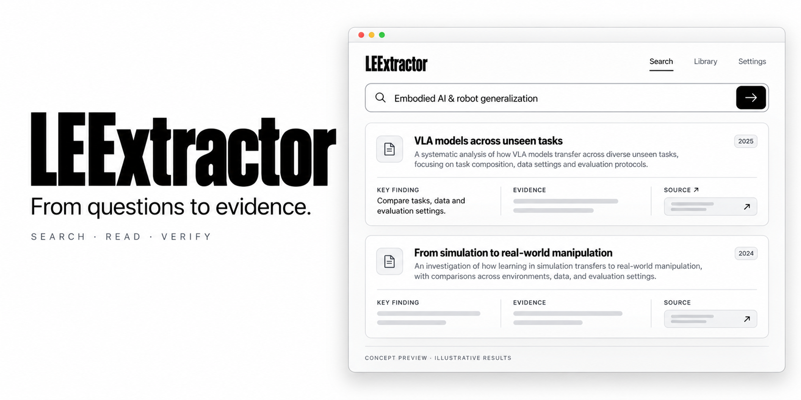
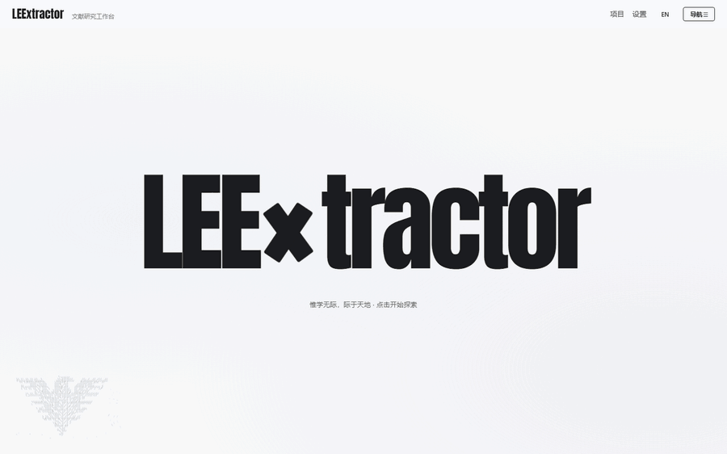
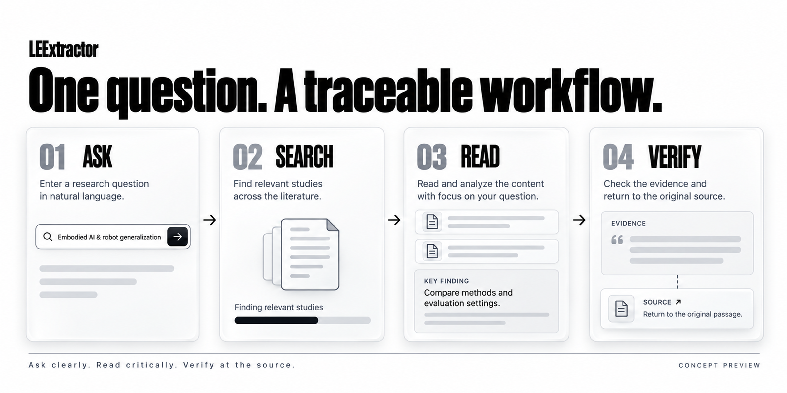

<div align="center">

# LEExtractor

<a id="preview"></a>



*产品概念*

**简体中文** · [English](README.en.md)

**从模糊的研究意图，走向可追溯的文献证据。**

Search literature. Trace evidence. Build understanding.

<p>
  
  
  
</p>

<p>
  
  
  
  <a href="LICENSE"></a>
  <a href="#start"></a>
</p>

[在线体验](https://leextractor.duckdns.org) · [产品预览](#preview) · [核心体验](#experience) · [开始使用](#start) · [实测数据](#benchmark) · [路线图](#roadmap) · [参与贡献](#contributing)

</div>

<br>



*实际操作录屏 · 热门样例「大语言模型幻觉」· 40 篇真实结果 · 3 个来源 8.0 秒（2 成功 / 1 受限）· [轻量版 GIF](docs/demo/leextractor-demo-small.gif)*

---

LEExtractor 面向科研前期探索：把一句模糊的研究意图，变成一次**有路径、有身份、有依据**的文献检索，再把整条链路留给下一个人复核。

**让每一次探索，都留下可回看的依据。**

> 当前版本已在公网运行（<https://leextractor.duckdns.org>），Windows 便携版可直接下载使用；未完成项见 [ROADMAP.md](ROADMAP.md) 与下文「能力边界」。

**四步工作流**



*探索流程*

| 步骤 | 你要做的事 | 系统的落地产物 |
| --- | --- | --- |
| **01 · 提问** | 输入研究主题或具体问题 | 意图拆成 object / method / task / scenario，中文方向本地中译英，译文可编辑 |
| **02 · 检索** | 发起多源检索 | 分库检索式可先查看，六源并发抓取，跨库按规范标识去重，来源状态逐源可见 |
| **03 · 阅读** | 浏览文献与发现依据 | 每条显示来源、评分上下文、发现方式（检索 / 引文 / 耦合 / 共被引） |
| **04 · 核对** | 回到原文与证据 | 引文证据图、有向证据路径、外部链接，以及可导入 Zotero 的导出件 |

<a id="experience"></a>

## 核心体验

以下能力**均已实现**，不是设想；每一项都附带自己的边界说明。

### 围绕一个研究问题检索

从一句自然语言描述出发，先看系统把哪些词放进了哪些槽位、每个库会收到什么检索式。识别不出的槽位会显示「未识别」，而不是编造一个看起来合理的词；中文问题配英文关键词时，检索式沿用关键词，解析结果仅作记录。

### 让失败有声音

限流、超时、鉴权失败逐库标记，缓存命中有原生标识，不会塌成「0 篇」；`TRUNCATED`（调用方限流截断，结果可用）与 `PARTIAL`（异常中断，不得作为覆盖证明）严格分开。诊断面板可展开逐阶段耗时与每源状态。

### 把发现过程留下来

每条文献都带发现轨迹：来自哪个库、哪一轮、什么查询、什么分数、什么证据。引文边与推导／语义边分开存放，PageRank 与证据路径只跑在引用边上。

### 由证据推出候选问题

组合空白、覆盖不足、无人跟进三类生成器，每条都带 rationale、支撑文献、最近似已有工作、风险与下一步检索式，并**一律标记为待验证假设**；少于 6 篇文献时不生成任何问题。

### 把判断权和交接件交给用户

排序是排序信号，不是筛选结论：人工筛选、阈值标定、全文获取各自保留事实。证据包含 `AGENT_HANDOFF.md`、`discovery_trace.jsonl`、`evidence_graph.json`、`landscape.json`、`questions.json`，可导入 Zotero 或交给 Codex / Qoder / WorkBuddy。

<a id="start"></a>

## 开始使用

### 在线体验

<https://leextractor.duckdns.org>

### Windows 便携版（推荐）

1. 下载并**完整解压** [`LEExtractor_v0.9.19_Windows_portable.zip`](download/LEExtractor_v0.9.19_Windows_portable.zip)（或从 [Releases](https://github.com/26Wesly3/LEExtractor/releases) 下载）。
2. 双击 **`Start_LEExtractor.bat`**。
3. 浏览器自动打开 <http://127.0.0.1:8012>，控制台保持打开即运行中。

启动器优先使用包内 `runtime\`，其次 `.venv`，再退到系统 Python；缺依赖会自动创建本地环境安装。**运行不需要 Node.js、显卡或推理 API Key。**

最小包不含模型权重：没有模型时**词法检索、来源筛选、证据链、导出全部可用**，只有中文翻译（约 116 MB）与语义排序（约 267 MB）会在首次使用时下载并缓存。端口被占用时先 `set LEEXTRACTOR_PORT=8013`。

### 源码运行

```powershell
git clone https://github.com/26Wesly3/LEExtractor.git
cd LEExtractor
python -m venv .venv
.\.venv\Scripts\python.exe -m pip install -e ".[web]" -c constraints.txt
.\.venv\Scripts\python.exe scripts\launch_web.py --port 8000
```

macOS / Linux 同上，改用 `python scripts/launch_web.py --port 8000`。加 `--skip-models` 可只开界面。

### 配置数据源

S2 / OpenAlex / SerpApi / Unpaywall 凭据可在界面「设置」页填写，或复制 `.env.example` 为 `.env`。**不要把 `.env` 提交到版本库。** 未配置密钥时限流可能让结果不完整，诊断面板会说明原因。

### 一个示例问题

```text
大语言模型的事实性幻觉与检索增强生成
```

→ 本地译文 `Increased creation of the virtual hallucinations and retrievals of large language models`
→ OpenAlex 关键词串 / arXiv 字段限定式 / Crossref 元数据补全，各自独立计数与去重。

<a id="benchmark"></a>

## 实测数据

BEIR SciFact test，全部 5,183 篇候选，从 300 个问题中用 seed 42 固定抽取 30 题，共 150 次真实排序；标签直接使用公开 qrels —— 未生成标签、未训练模型、未按成绩调参。

| 方法 | nDCG@20 ↑ | Recall@50 ↑ | P@20 ↑ | MRR@50 ↑ |
| --- | ---: | ---: | ---: | ---: |
| **当前混合排序** | **0.6800** | **0.8767** | **0.0467** | **0.6379** |
| BM25 关键词参照 | 0.6631 | 0.8433 | 0.0450 | 0.6367 |
| 现有关键词排序 | 0.5941 | 0.8100 | 0.0450 | 0.5339 |
| 本地向量：仅标题 | 0.5438 | 0.7300 | 0.0350 | 0.5040 |
| 本地向量：标题＋摘要 | 0.4856 | 0.7367 | 0.0383 | 0.4268 |

**口径（我们不夸大）**：相对项目原有关键词排序 nDCG@20 **+0.0859**，配对 bootstrap 95% 区间 `[0.0080, 0.1773]`（不跨零）；相对 **BM25** 仅 +0.0169，区间 `[-0.0612, 0.1015]` **跨过零 —— 因此不宣称稳定优于 BM25**。完整逐题结果与复算方法见 [`benchmarks/results/scifact-pilot-2026-10-10/`](benchmarks/results/scifact-pilot-2026-10-10/SUMMARY.zh-CN.md)。

```powershell
python -m scripts.run_public_benchmark --queries 30 --seed 42   # --queries 0 可扩到全部 300 题
```

## 能力边界

- 相关性是**排序信号**，不是筛选判断或研究质量评价。
- 语义重排只重排上游已返回的候选，**无法找回上游没返回的论文**。
- 计数单位是 record / report，同一研究的多个报告尚未归并到研究层面。
- 自动全文综述、创新性评分、Zotero 双向同步、机构访问、多用户隔离均**尚未实现**。
- 当前为单用户本机（或单实例云）工作流，不是多租户服务。

<a id="roadmap"></a>

## 路线图

| 状态 | 内容 |
| --- | --- |
| **进行中** | 真实场景用户测试与数据积累；在可比实验条件下引入语义增强（RRF / weighted sum 对照） |
| `pending_external` | 3–5 个真实案例的冻结数据集（人工金标准）；带凭据的真实 provider smoke |
| `planned` | 五组检索基线对照；Graph Benchmark；全库向量召回 |
| `deferred` | Zotero 双向同步；机构访问；GROBID 全文结构化；Screening 与 PRISMA 完全解耦；多用户隔离 |

完整三态清单见 [ROADMAP.md](ROADMAP.md)，逐版本改动见 [CHANGES.md](CHANGES.md)。

## 目录结构

```text
app.py                  Streamlit 入口（保留）
litsearch/              领域算法与数据源
  sources.py            六源抓取与统一传输
  retrieval.py          RetrievalResult 状态语义
  filters.py            词法与语义融合排序
  intent.py             研究意图解析与分库检索式
  prisma.py             两阶段筛选与流程计数
  landscape.py          研究版图
  questions.py          候选研究问题
  web/                  FastAPI 服务与任务管理
web/                    Vue 3 + Vuetify 工作台源码
scripts/                启动、打包、Benchmark
benchmarks/             评测数据、指南与实测结果
docs/                   DevLog、ADR、图片素材、演示录屏
download/               Windows 便携版下载件
```

## 开发与验证

```powershell
.\.venv\Scripts\python.exe -m pytest -q          # 离线测试
.\.venv\Scripts\ruff.exe check .                 # 静态检查
python -m scripts.launch_web --port 8000         # Web 工作台
python server.py                                 # MCP（12 工具）
```

前端：`cd web && npm ci && npm run dev`；发布前 `npm run build` 再 `python scripts/sync_web_assets.py`。

| 文档 | 内容 |
| --- | --- |
| [CHANGES.md](CHANGES.md) | v0.3.0 → 当前版本全部改动 |
| [CHANGELOG.md](CHANGELOG.md) | 使用者视角版本级变化 |
| [ARCHITECTURE.md](ARCHITECTURE.md) | 模块与不变量 |
| [DEPLOYMENT.md](DEPLOYMENT.md) | 服务器部署、回滚与健康检查 |
| [ONBOARDING.md](ONBOARDING.md) | 团队接手 |
| [docs/devlog/](docs/devlog/) | 逐版本工程记录（Before / After） |

<a id="contributing"></a>

## 参与贡献

欢迎提交 Issue 与 Pull Request。反馈问题时请附**版本、复现步骤、预期结果与实际结果**；分享日志或会话前请移除密钥（`.env`、API Key、机构凭据）。

## 贡献者与许可

[GlueGPT](https://github.com/GlueGPT) · [jvligyh](https://github.com/jvligyh)

本项目以 **MIT License** 开源，见 [LICENSE](LICENSE)；第三方数据与模型权重不适用本许可，见 [THIRD_PARTY_NOTICES.md](THIRD_PARTY_NOTICES.md)。
