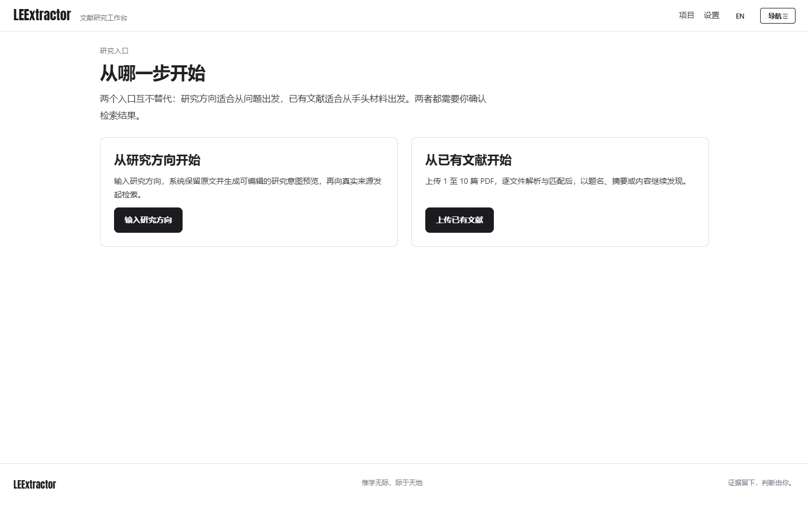
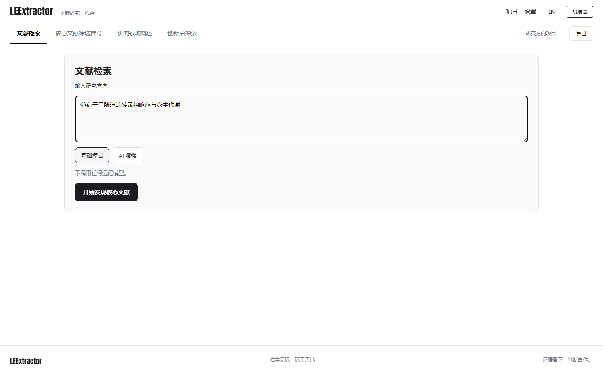
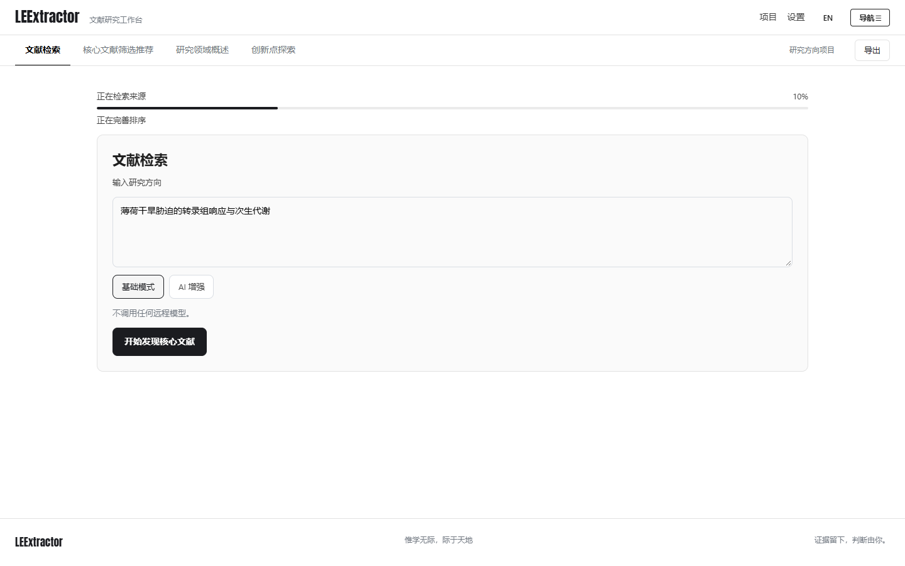
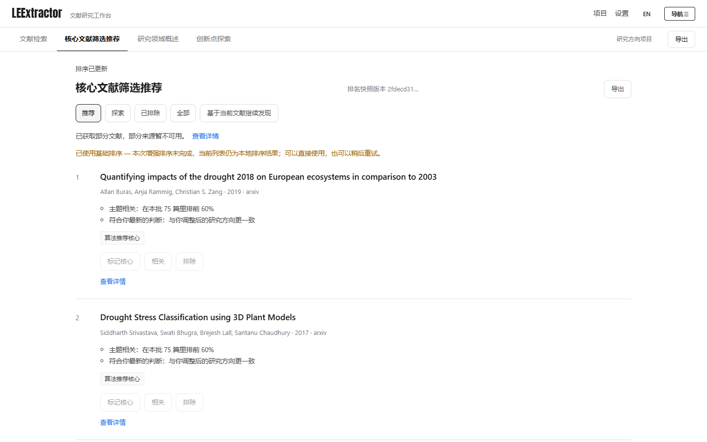
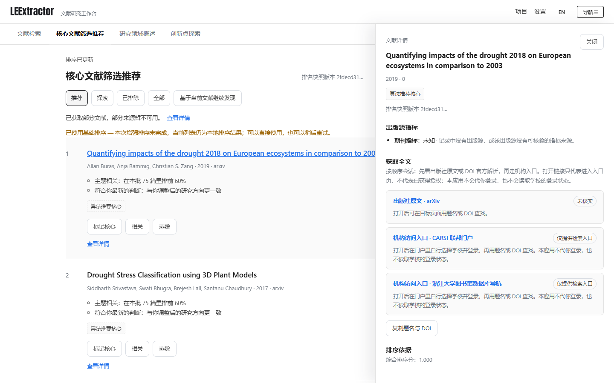
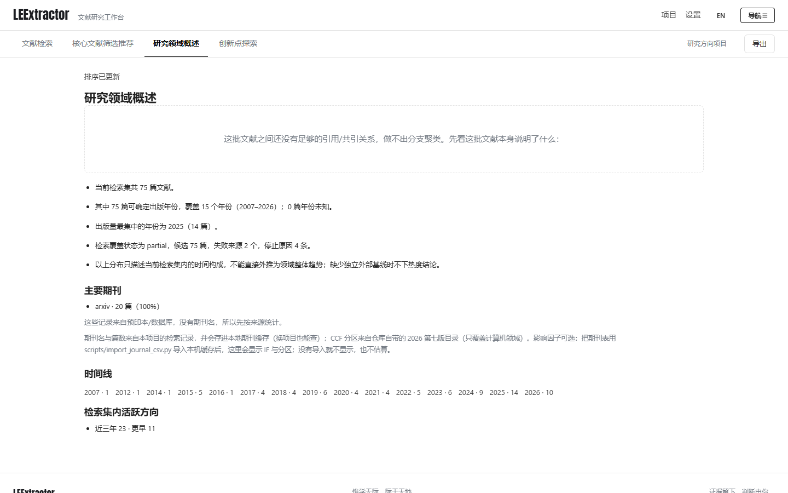
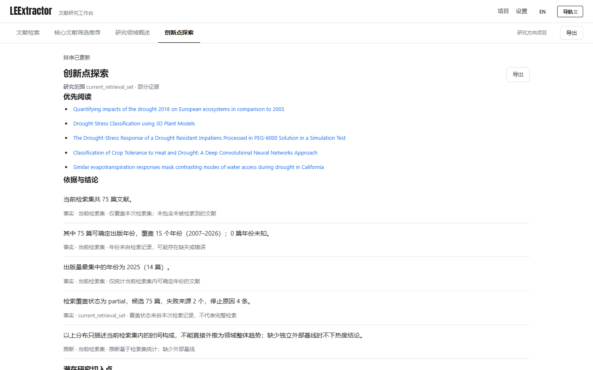
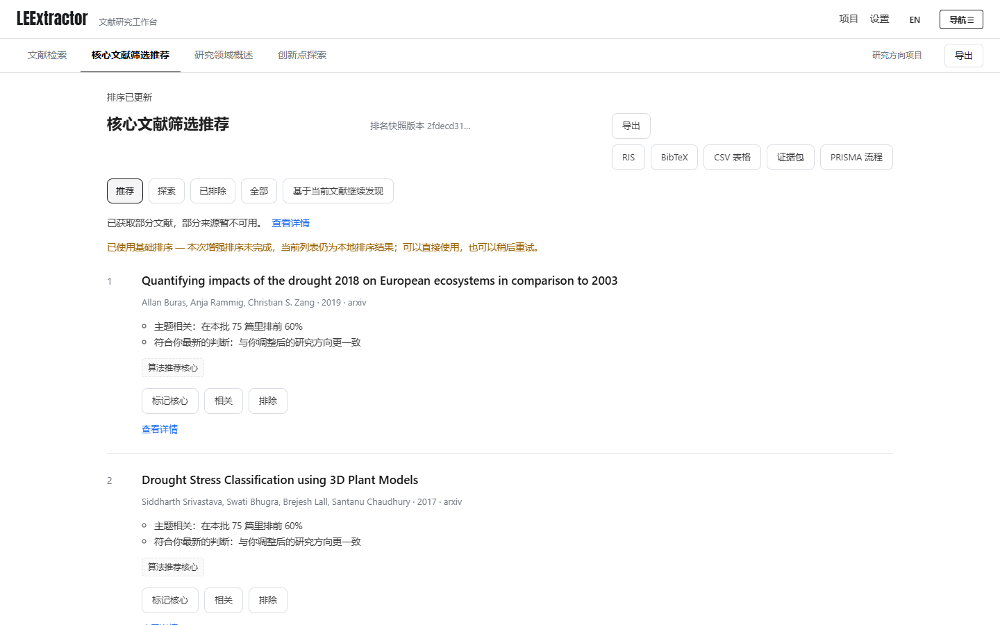

# LEExtractor 端到端演示（2026-10-17 实测）

一次真实跑通：入口 → 文献检索 → 核心文献筛选推荐 → 研究领域概述 → 创新点探索 → 导出。
没有 mock：真实浏览器（Chrome）、真实后端（`127.0.0.1:8000`）、真实检索来源。

- 演示脚本：`web/e2e-demo.mjs`
- 复跑：`cd web && node e2e-demo.mjs`（默认打本机 8000，可用 `E2E_BASE` 改）
- 本次主题：`薄荷干旱胁迫的转录组响应与次生代谢`
- 本次结果：**75 篇候选**，检索耗时 **55 秒**，20 张卡片（首屏），覆盖状态 `partial`

## 1. 入口：两条路都通



「从研究方向开始」和「从已有文献开始」互不替代：前者按方向检索，后者上传 PDF 后从题名/摘要继续发现。

## 2. 文献检索：输入方向后开始



中文方向会先翻译成英文再发检索（否则 OpenAlex/Crossref 只会返回无关记录），原文保留在项目锚点里。

## 3. 进度：真实任务，不是假动画



阶段与百分比来自后台任务（`retrieving → fast_ranking → …`），刷新页面会接着显示同一个任务。

## 4. 核心文献筛选推荐：推荐理由是大白话



每条理由先说结论再说依据：

- `主题相关：在本批 75 篇里排前 60%`
- `符合你最新的判断：与你调整后的研究方向更一致`
- `你手动选进了推荐：这篇由你决定，不是算法挑的`

顶部如实标注 `已获取部分文献，部分来源暂不可用。` 与 `已使用基础排序`（本次未启用 AI 增强，也没有花模型额度）。

## 5. 文献详情抽屉



详情进 URL（`?paper=`），刷新、后退、分享链接都能回到同一条记录；抽屉有 260ms 退场动画。

## 6. 研究领域概述：没有关系数据也不留空



这批记录之间没有足够的引用/共引关系，所以不做分支聚类——但也不交白卷，而是把这批文献本身说得清的事实列出来：总量、年份跨度、峰值年份、覆盖状态；再加上时间线与近年活跃方向。

「主要期刊」在记录只有预印本/数据库来源（本次全部来自 arXiv）时按**来源**统计，并说明为什么没有期刊名。期刊名一旦出现，会进入本地期刊缓存；CCF 分区来自仓库自带目录（仅计算机领域），影响因子用 `scripts/import_journal_csv.py` 导入后显示。

## 7. 创新点探索



规则生成的线索 + 覆盖范围 + 状态，全部可追溯到检索集内的记录。

## 8. 导出：五种格式



RIS / BibTeX / CSV / 证据包 / PRISMA 流程。证据包不含任何 Key 或本机路径。

## 本次跑出来的三个真问题（已修）

1. **覆盖率自相矛盾**：75 篇候选却显示「确实没有匹配文献」。根因是自动扩展轮之后候选变多，但快照里的 `coverage.status` 还停在前一轮；现在 `coverage_dto` 保证「有结果就不会报 no_results」，概览读快照时也会重新归一化，界面优先用任务自己记录的覆盖状态。测试：`tests/test_v32_coverage_status.py`。
2. **概述留白**：「关系数据不足」只剩一句话。现在补齐事实清单、来源/期刊统计。
3. **等待逻辑太脆**：演示脚本原来死等进度条消失，任务完成也会判失败。改成轮询「出现结果或超时」。

## 诚实的边界

- **AI 增强未启用**：本次全程基础排序，没有发生任何模型调用（不消耗你的额度）。要验证模型，请在项目里选「AI 增强」再跑一次。
- **覆盖是 partial**：`failed_sources` 含 Semantic Scholar 等 2 个来源，停止原因为「自动扩展轮达到上限 / 无新结果 / 速率限制」。这是真实观察，不是成功。
- **没有分支聚类**：这批初检记录缺少引用关系；扩到更多轮或导入带参考文献的 PDF 之后才有。
- **期刊信息**：记录来自 arXiv，没有期刊字段；影响因子需要本地导入期刊表。

## 复现步骤

```bash
# 1) 起服务（仓库根目录）
python -m litsearch.web --port 8000

# 2) 跑演示（另开一个终端）
cd web && node e2e-demo.mjs

# 3) 产物
#    docs/demo/screenshots/*.png   截图
#    docs/demo/screenshots/summary.json  本次摘要（项目 id、计数、耗时、问题列表）
```
